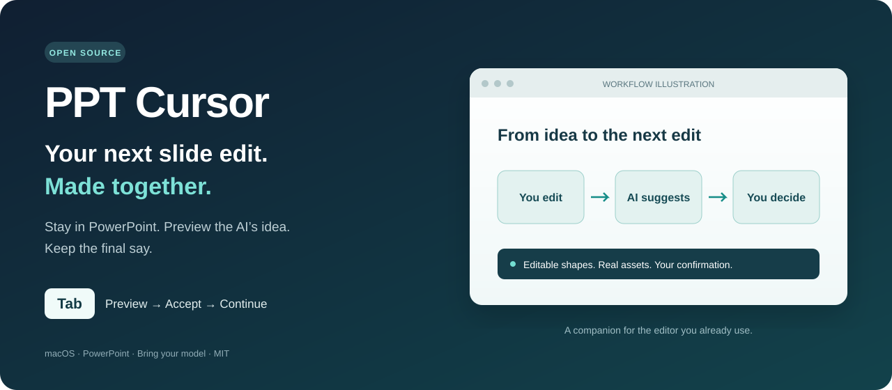
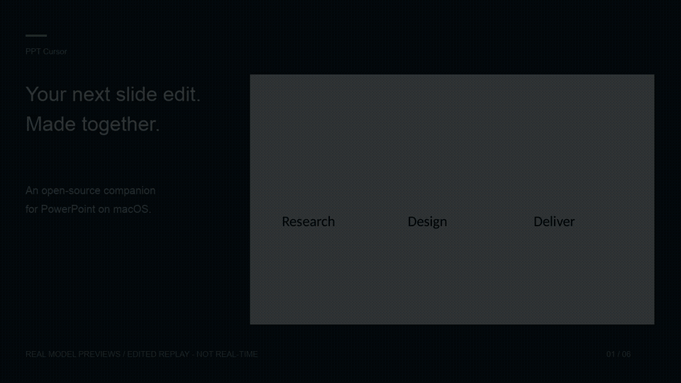

<p align="center">
  
</p>

<p align="center">
  <a href="https://github.com/genalyu/ppt-cursor/actions/workflows/preview.yml"></a>
  <a href="LICENSE"></a>
  
  
</p>

<p align="center">
  简体中文 · <a href="README_EN.md">English</a><br />
  <a href="#开始使用">开始使用</a> · <a href="docs/USER-GUIDE.zh-CN.md">使用指南</a> · <a href="docs/PRODUCT-PLAN.md">路线图</a> · <a href="CONTRIBUTING.md">参与贡献</a>
</p>

**PPT Cursor 是住在 PowerPoint 旁边的开源 AI 编辑助手。** 你继续编辑熟悉的 PPTX，AI 根据当前页和最近改动提出下一步建议。先看预览，再按 Tab 或点击采纳；文字编辑时可用 ⌥⌘Return。

你负责方向与判断，AI 帮你接着做。每次写入前重新核对当前页，避免把过时的建议应用到新内容。

> 当前为 macOS 预览版。需要桌面版 PowerPoint、本机 Python/Pillow 和 LibreOffice，以及可用的模型连接。应用尚未 Apple 公证；完整兼容性验证仍在进行。顶部图是工作流程示意，实际功能以本文与验证记录为准。

## 看看协作过程

[18 秒项目介绍](docs/media/promo.mp4) · [74 秒演示回放](docs/media/demo.mp4) · [字幕与素材来源](docs/media/README.md)

下面是本次真实模型输出的剪辑回放，包含五轮连续采纳、按明确要求修改文字，以及自主搜索配图。**不是实时录屏；播放时长不代表响应速度。**

[](docs/media/demo.mp4)

## 可以一起做什么

| 场景 | PPT Cursor 的工作方式 |
| --- | --- |
| 说清怎么改 | 在「本次修改要求」输入具体目标，针对当前页生成一条建议；预览确认后采纳 |
| 完成布局 | 移动、缩放、旋转；纯几何修改采用快速示意预览 |
| 继续编辑 | 支持文本、统一字号／加粗／斜体、部分原生图形和组合图形修改，采纳后继续提出建议 |
| 找到配图 | 模型自行提出关键词，搜索 Commons 公有领域／CC0 素材，预览后插入；上传图片是可选补充 |
| 保持控制 | 采纳、忽略、暂停、重新预测；切换应用时暂停展示，返回后重新核对 |
| 知道进展 | 区分预测、搜素材、生成预览、待采纳、写入等状态，处理阶段显示已用时间 |
| 接着上次做 | 已采纳对象保留本地恢复缓存，支持未保存插入对象后的会话恢复 |

控制窗口提供修改要求输入、当前建议缩略图和采纳／忽略入口；浮动预览固定在 PowerPoint 窗口左下角，采纳按钮位于其上方。等待系统钥匙串授权时窗口保持响应。复杂替换可能只能另存为建议副本。详细支持范围和故障处理见[使用指南](docs/USER-GUIDE.zh-CN.md)。

## 开始使用

### 下载预览版

[下载 v0.1.0-preview.43 · Apple Silicon](https://github.com/genalyu/ppt-cursor/releases/download/v0.1.0-preview.43/PPT-Cursor-macOS-arm64.zip) · [发布说明与校验文件](https://github.com/genalyu/ppt-cursor/releases/tag/v0.1.0-preview.43)

解压后打开 `PPT Cursor.app`。仍需本机 PowerPoint、Python 3 + Pillow 和 LibreOffice；模型连接在应用内配置。Intel Mac 当前请从源码构建。此包已通过 CI 测试和打包校验，但尚未 Apple 公证。

### 从源码构建

环境：macOS 13+、Xcode Command Line Tools（Swift 5.9+）、Python 3、Microsoft PowerPoint、LibreOffice。

```sh
git clone https://github.com/genalyu/ppt-cursor.git
cd ppt-cursor
python3 -m venv .venv
. .venv/bin/activate
pip install -r requirements.txt
./Scripts/check-environment.sh
./Scripts/build-app.sh
open "dist/PPT Cursor.app"
```

[其他版本](https://github.com/genalyu/ppt-cursor/releases)。核对 release 说明中的提交、架构和依赖。本地源码构建会优先使用项目 `.venv`，移动应用后需确保常见 Python 安装位置中有 Pillow。

### 第一条建议

1. 复制并打开 [Tab-Demo.pptx](Examples/Tab-Demo.pptx)，保留原始示例。
2. 在「模型连接…」选择 Codex CLI、OpenAI 或阿里云百炼。API 密钥保存在 macOS 钥匙串；Codex CLI 需先登录。
3. 点击「开始预测」，切回 PowerPoint，编辑并松开鼠标。
4. 看清预览后按 Tab 或点击「采纳当前建议」。不合适就忽略；暂时不需要就暂停。

每次采纳后自动继续，没有三次或固定次数上限。临时失败和空建议按 15、30、60 秒间隔重试；权限与鉴权问题需要修正连接。持续运行会产生后续模型调用。

## 速度：分阶段说明

常见文字修改和新增图形使用简短指令，由应用保留格式或生成原生可编辑图形，减少模型输出量。同机公开测试文稿的实测如下（不含人工审阅和后台等待）：

| 场景 | 模型响应 | 预览渲染 |
| --- | --- | --- |
| 两次文字修改 | 1.793 / 2.106 秒 | 2.621 / 2.636 秒 |
| 三个对齐的编号标签 | 4.608 秒 | 2.404 秒 |
| 采纳后的下一条图形建议 | 6.686 秒 | 1.732 秒 |

同页受控渲染基准中，会话复用临时配置将后续完整预览从 **2.206–2.276 秒降到 1.499–1.517 秒**，像素和 PPTX 内容一致，首轮仍需初始化。纯几何示意预览的一次样本为 0.103 秒。

这些是具体样本，不是通用响应时间承诺。复杂图形仍可能需要较长的模型输出；网络素材搜索还会增加一次模型选择调用。三个编号的等价指令为 517 字节，对应完整图形描述 2,626 字节；这不等于所有任务都获得相同比例的提速。

[测量和验证记录](docs/QA-2026-11-28.md) · [完整质量计划](docs/PRODUCT-PLAN.md)

## 数据去向

- **所选模型**：当前页文字、对象属性、最近最多 8 个内容状态；截图默认关闭，启用后发送整页渲染图。
- **素材搜索**：模型生成的关键词发给 Wikimedia Commons，候选图片和来源信息提供给模型。提示词要求避开敏感名称，但不保证自动脱敏。
- **本机**：密钥存钥匙串；已采纳副本缓存最多 12 页、7 天，恢复时核对源文件版本和对象结构，不替你保存原稿。

没有应用分析埋点。[完整安全与数据说明](SECURITY.md)。

## 贡献与维护

欢迎可复现的问题、真实使用反馈和聚焦的改进。请勿在 issue 中上传密钥或私人文稿。

```sh
./Scripts/test-offline.sh
# 可选：使用 LibreOffice 复现渲染性能对比
python3 Scripts/test-fast-preview.py --benchmark
```

[贡献指南](CONTRIBUTING.md) · [问题反馈](https://github.com/genalyu/ppt-cursor/issues/new/choose) · [路线图](docs/PRODUCT-PLAN.md) · [MIT License](LICENSE)
