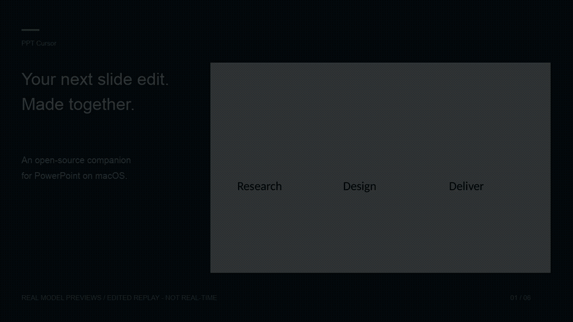

<p align="center"></p>

<p align="center"><a href="README.md">简体中文</a> · English · <a href="https://github.com/genalyu/ppt-cursor/actions/workflows/preview.yml">Build &amp; tests</a> · <a href="LICENSE">MIT</a></p>

**An open-source AI editing companion for PowerPoint on macOS.** Keep working in your PPTX. PPT Cursor uses the current slide and recent edits to suggest what comes next. Review the preview, then press Tab or click Accept. Use ⌥⌘Return while editing text.

You keep the final say. Every write rechecks the document and slide baseline.

> Preview software. Requires macOS 13+, desktop Microsoft PowerPoint, Python/Pillow, LibreOffice and a working model connection. Not notarized by Apple. The banner is a workflow illustration; compatibility validation remains ongoing.

## See the workflow

[18-second overview](docs/media/promo.mp4) · [74-second demo](docs/media/demo.mp4) · [Captions and credits](docs/media/README.md)

An edited replay of real model previews: five consecutive accepted edits, an explicit text-edit request, and an autonomously searched image. **Not a real-time screen recording; scene durations are not latency measurements.**

[](docs/media/demo.mp4)

## Features

- Give an explicit editing request for the current slide, then preview and accept the proposed change.
- Move, resize and rotate shapes, with a fast geometry preview.
- Edit text, uniform font size, bold and italic styles, and supported native shapes; compose grouped visuals.
- Let the model search public-domain/CC0 images on Wikimedia Commons, choose a real candidate and preview its placement. Uploaded references are optional.
- Review the current suggestion in the control window, accept or dismiss it, pause or retry.
- Follow live prediction, image search, rendering and writeback phases with elapsed time.
- Continue after acceptance; recover accepted unsaved objects across worker restarts using bounded local checkpoints.
- Keep using the control window while macOS waits for Keychain authorization; an existing in-memory connection does not need another key read or rewrite.

Complex replacements may require saving a suggested copy. The floating preview stays in the lower-left of the PowerPoint window, with acceptance controls above it. Review each proposed edit before accepting.

## Download

[Apple Silicon preview v0.1.0-preview.45](https://github.com/genalyu/ppt-cursor/releases/download/v0.1.0-preview.45/PPT-Cursor-macOS-arm64.zip) · [Release notes and checksum](https://github.com/genalyu/ppt-cursor/releases/tag/v0.1.0-preview.45)

Unzip and open `PPT Cursor.app`. PowerPoint, Python 3 with Pillow and LibreOffice are still required locally. Configure the model in the app. Intel Mac users currently need a source build. This package passed CI tests and packaging checks; it is not Apple-notarized.

Use **环境检查… (Environment Check)** in the app or menu to find missing local dependencies without reading the Keychain. The copyable summary excludes credentials, slide contents and full local paths. Installation checks do not verify model login or network access. [Troubleshooting guide](docs/USER-GUIDE.zh-CN.md#环境检查).

## Build and run

Install Xcode Command Line Tools (Swift 5.9+), Python 3, PowerPoint and LibreOffice, then:

```sh
git clone https://github.com/genalyu/ppt-cursor.git
cd ppt-cursor
python3 -m venv .venv
. .venv/bin/activate
pip install -r requirements.txt
./Scripts/check-environment.sh
./Scripts/build-app.sh
open "dist/PPT Cursor.app"
```

[Other releases](https://github.com/genalyu/ppt-cursor/releases): check the commit, architecture and dependencies. Source builds discover the repository's `.venv`; relocated apps require a Python installation with Pillow in a supported location.

1. Open a copy of [Tab-Demo.pptx](Examples/Tab-Demo.pptx) in PowerPoint.
2. Configure Codex CLI, OpenAI or Alibaba Cloud Bailian in the model settings. API keys stay in macOS Keychain; Codex CLI must already be signed in.
3. Start prediction and return to PowerPoint. Edit, release the mouse and review the suggestion.
4. Accept, dismiss, or pause. Accepted changes lead to another suggestion without a fixed round limit.

Transient errors and empty proposals retry with 15/30/60-second backoff; authorization errors require fixing the connection. An active session can make repeated billable model requests.

## Performance and verification

A measured geometry-render example took **0.103 seconds**, versus **2.998 seconds** with LibreOffice on the same machine. This is one rendering-stage measurement, **not end-to-end latency**. Text, new shapes and images still need full rendering. Model response latency depends on the provider, model and context. Image search adds network work and a second model call.

Common text edits and new native shapes use compact instructions. Actual qwen4-max samples, excluding user review and background waiting:

| Scenario | Model response | Preview rendering |
| --- | --- | --- |
| Two text edits | 1.793 / 2.106 s | 2.621 / 2.636 s |
| Three aligned number labels | 4.608 s | 2.404 s |
| Next automatic shape suggestion | 6.686 s | 1.732 s |

Session profile reuse reduced warm full-preview time from **2.206–2.276 s to 1.499–1.517 s** in a same-slide benchmark, preserving all RGBA pixels and PPTX parts. Cold initialization remains. A three-label response is 517 bytes in compact form versus 2,626 bytes as DrawingML. Neither the payload reduction nor these samples imply a fixed speedup for every model or document; complex styling retains the full DrawingML path.

[Validation notes](docs/QA-2026-11-28.md) distinguish mocked regressions from live provider requests and actual PowerPoint writes. [Quality roadmap](docs/PRODUCT-PLAN.md).

## Privacy

The chosen model receives slide text, object properties and up to eight recent content states. Whole-slide images are off by default. Search keywords go to Wikimedia Commons; candidate images and source metadata go to the model. The prompt requests generic keywords, which is not a guarantee of sensitive-data redaction.

Accepted snapshots are cached locally for at most twelve pages and seven days, with source/structure checks before restoration. The app does not automatically save your original file. No application analytics are implemented. [Security and data handling](SECURITY.md).

## Development

```sh
./Scripts/test-offline.sh
python3 Scripts/test-fast-preview.py --benchmark # optional LibreOffice comparison
```

[Contributing](CONTRIBUTING.md) · [Report an issue](https://github.com/genalyu/ppt-cursor/issues/new/choose) · [MIT License](LICENSE)
