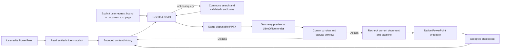

# Architecture

PPT Cursor is a macOS menu-bar app with a Swift/AppKit controller and a Python staging worker. It edits the user's current PowerPoint document only after an explicit acceptance and a fresh baseline check.

## Ownership

| Component | Responsibility |
| --- | --- |
| `Sources/CursorApp/main.swift` | App lifecycle, session process, model configuration, user commands and phase feedback |
| `EnvironmentDiagnostics.swift` / `EnvironmentWindow.swift` | Local dependency checks with bounded Python probes, actionable results and a path-redacted summary; no Keychain access |
| `SessionPhase.swift` | Shared worker event vocabulary, elapsed labels and explanations |
| `DocumentFollowPolicy.swift` | Reject stale document observations and transient staging-document activations |
| `PreviewPlacement.swift` | Keep the floating preview and controls in the visible lower-left of the PowerPoint window |
| `StagedSubmission.swift` | Distinguish ready/exporting/writing/failed; failed proposals retain recovery controls but cannot be accepted twice |
| `StagedPreview.swift` | Display proposal, suspend on focus changes, route acceptance and recheck before applying |
| `Sources/MacIntegration` | PowerPoint snapshots and guarded native writeback, with rollback checks |
| `Scripts/stage-drawing.py` | Context, provider calls, untrusted DrawingML validation, staged PPTX, rendering and session recovery |
| `Scripts/shape_inserts.py` | Validate compact additions and compile them to self-contained editable shapes/groups without replacing existing objects |
| `Scripts/web_assets.py` | Bounded Commons search, license filtering, URL/redirect validation and raster normalization |

## Important boundaries

- The app sends API settings through the worker's standard input. Keys are not command arguments, proposal files or logs.
- Explicit editing requests use a private session file and are bound to the captured document/page before inference. A page switch cancels the request. Acceptance consumes it and restores automatic suggestions; dismissal may request another candidate for the same instruction.
- Keychain reads and writes run off the AppKit event loop. Reusing a live connection avoids another key read/write. Authorization failure keeps the previous connection preferences intact.
- Preview `metrics.json` records proposal format and model/search/render durations, without slide contents, prompts or credentials. It shares the temporary preview lifecycle rather than creating persistent telemetry.
- Sequential exports share a private session-owned LibreOffice profile through a nested render context. A failed export invalidates that profile, independent workers receive distinct profiles, and session cleanup removes it. The output directory and staged document remain per-proposal; no preview or baseline verification is skipped.
- A phase event describes real work. The control window and menu bar use the same phase/elapsed function. Session diagnostics contain phase names and timestamps, not API keys or slide text.
- Text snapshots include known uniform bold/italic values. Compact edits expand locally into the existing DrawingML, and native equivalence must account for every difference. The writer checks every run and restores touched properties after a later failure; unknown/mixed styles cannot be assigned as a whole-range native edit.
- Normal shutdown writes a session-local stop marker, then acquires the worker's exclusive preview lock off the UI thread before signalling the process group. The worker holds this lock through native preview/writeback and accepted-checkpoint persistence. The preview rejects new acceptance after stop and processes stop only outside write/export work. Controller ownership remains until observed exit; replacement sessions and normal quit wait for that boundary. This protocol does not promise recovery from an OS force-kill or power loss.
- Acceptance is bound to the displayed proposal and current slide baseline. Faster rendering must never weaken that comparison.
- PowerPoint temporarily opens a staged deck to copy native content. The document follower must not treat that as the user's navigation: writeback invalidates pending observations and suspends following; a subsequent switch requires repeated observation.
- Swift omits nil optional fields while JXA may emit null. Content comparisons normalize these representations so a capture does not create a false editing transition.
- Model output and asset metadata are untrusted. The model does not directly execute arbitrary scripts or supply unchecked download URLs.
- Search is optional work selected by the model. User references remain independent inputs. A search failure can return to ordinary editing.
- Checkpoints are private, bounded, revision/structure checked and separate from the user's original file. They preserve accepted unsaved content; they do not authorize saving the original.

## Testing

`Scripts/test-offline.sh` checks the deterministic parts without provider credentials, network requests or live PowerPoint edits. Live acceptance requires a disposable public example, a configured model, an interactive desktop and separate verification of the final PowerPoint state. Synthetic shortcut events must not be described as a physical keyboard test.
