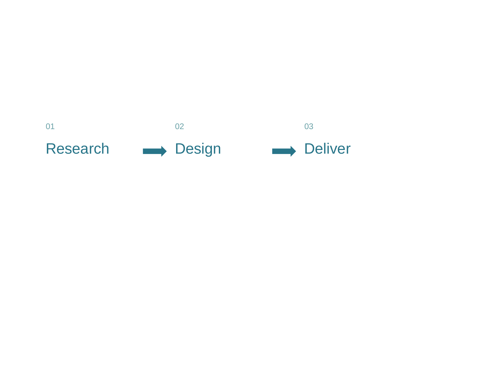

# UX and performance review — 2026-11-28

This review used the actual source repository and disposable copies of `Examples/Tab-Demo.pptx`. The first review below predates publication; later sections record follow-up fixes and releases. Build 38 was subsequently published and its downloaded archive verified.

## Initial review (before the continuous-session follow-up below)

| User-visible problem | Result |
| --- | --- |
| Start/pause/retry and menu acceptance controlled a different prediction path | Default controls now target the active native session; pause terminates its process group, and commands do not carry into a later preview |
| Opening the app could leave no usable window | Startup and reopen expose the control window; starting a session returns to PowerPoint |
| No clear route back from settings to the slide | Added a Return to PowerPoint button |
| API connection fields were squeezed into a narrow column | Explicit label/field widths, full endpoint, secure key field, retained provider preferences |
| Rebuilt application could hang before its first window on a Keychain ACL prompt | Background restore, noninteractive startup reads, explicit recovery state; interactive authorization only when reusing a key from Save Connection |
| Empty/invisible suggestions could loop indefinitely | At most one alternative request for unchanged content |
| Idle time and foreground switches repeatedly spent API calls | No automatic re-review of unchanged content |
| Invalid credentials and temporary provider failures were retried indiscriminately | No authentication/quota auto-retry; transient network/5xx errors retry twice, after 15 and 30 seconds |
| Geometry edits incurred full LibreOffice rendering | Pure validated transforms use a labeled geometry diagram while preserving a staged PPTX |
| Preview repeatedly captured/located the page at 4 Hz | Expensive verification capped at 1 Hz; immediate focus/mouse/window checks and pre-write validation remain |
| Finder could miss the project's Python environment | Local dist builds discover the repository .venv; dependency checker and documented setup added |
| Documentation contradicted current credentials/provider behavior | Replaced quick start, limitations and troubleshooting; added contribution/security guides and an offline test runner in CI |

## Measured rendering comparison

Same public three-text-box fixture, same shape move, same machine:

- Full LibreOffice render: **2.998 seconds**.
- Geometry preview: **0.103 seconds** (about **29×** faster for this stage).
- Both create a staged editable PPTX; the fast path is explicitly a placement/size diagram, not a pixel-perfect slide render.
- These numbers exclude provider response, live capture, and time waiting for PowerPoint focus. They are not end-to-end latency claims or a general hardware benchmark.

Reproduce with `python3 Scripts/test-fast-preview.py --benchmark`.

## Validation

- `Scripts/test-offline.sh`: passed. This includes Swift build, history assertions, simulated provider errors, stale/background predictions, no-op limits, manual retry, three consecutive acceptances and follow-up state, fast rendering, API ordering, cancellation, and page location.
- This Mac has Command Line Tools without XCTest. The runner used the existing swiftc history harness. Full XCTest remains enabled on CI hosts with XCTest; no remote CI run is claimed here.
- `Scripts/test-hotkey.sh`: passed Carbon registration, event routing, collision fallback and release. This is not a physical keyboard test.
- `Scripts/build-app.sh`: release build and strict code-signature verification passed. Build 35 is ad-hoc signed, not notarized.
- Real model: existing qwen4-max connection returned a valid proposal to align Deliver from y=200 to y≈198.244 after Research and Design were nudged to that row. It produced the new geometry preview and guarded acceptance payload.
- UI: verified start/pause controls and worker shutdown; inspected connection layout and successful startup with an inaccessible Keychain item.

## Remaining acceptance gate

The rebuild changed the ad-hoc signature and initially required the owner to authorize access to the existing Keychain item. The automation tool cannot operate SecurityAgent. The owner completed authorization and the running app restored qwen4-max; no further signing changes were made. A separate noninteractive `--check-model` process still could not read the Keychain credential, so persistent cross-process access is not verified; the currently running app retains the authorized API settings. Stable release signing and the owner's Keychain access choice remain relevant. The app shows inaccessible credentials as an actionable connection state rather than freezing.

The desktop tool's directed Tab input changed the PowerPoint selection without a verified acceptance record. Therefore **physical Tab acceptance across three real-model rounds is not verified**. Three-round state-machine coverage is simulated and must not be described as that desktop test. The test session was paused through the UI afterward, with the model configuration retained.

Screen recording permission, complex backgrounds and varying slide layouts can still require thumbnail fallback. Complex replacements may require Save Copy. Formal signing/notarization and a broader macOS/PowerPoint compatibility matrix remain release requirements.

## Follow-up: continuous use beyond the first three acceptances

The user confirmed that three real acceptances worked, then reported a stall. Inspection found two concrete stop conditions: empty-result/error recovery could require a manual retry indefinitely, and restarting a session discarded the staged copies needed for unsaved inserted groups. The current live test page had five top-level objects while its disk file still had three (the missing groups were Process Arrows and Step Numbers).

This follow-up supersedes the limited-retry policy above. Empty results, transient provider/format errors and dismissed/interrupted previews now continue automatically, with bounded delays rather than a bounded total attempt count. Authentication failures still require valid credentials. Accepted PPTX checkpoints survive worker restart, are version/structure checked, and have private permissions, a twelve-page cap and seven-day expiry. The old test copy was saved once through PowerPoint to recover the already-lost pre-fix staging state; normal future acceptance does not save the user's source file.

Validation: fifty consecutive simulated acceptances and prediction 51; eight-state history remains bounded. A real preview path is reached after ten successive simulated empty, network-error or malformed responses. Checkpoint tests cover inserted-object recovery without saving the source, session-level baseline/history restoration, source-revision/structure rejection, corrupt-cache rejection and cache bounds. These automated rounds are regression evidence, not a claim of fifty physical keyboard presses.

After installing the updated worker and resuming the saved five-object test slide, the live qwen4-max session generated another staged preview: a “Process Overview” title above the process labels. This verifies a new real suggestion beyond the user's previously accepted three, not acceptance of that new suggestion.

## Follow-up: live phases and automatic web assets (build 36)

The worker now reports actual read, prediction, search, rendering and preview/writeback phases; the menu adds elapsed seconds for active work and distinct waiting, paused and connection-error states. Startup and launch errors also leave the reading state.

The model can request a Commons search without imported images, inspect downloaded candidates, and select an image and placement. Uploaded images remain available alongside web results. Search failure falls back to ordinary editing. Eligible assets are public domain/CC0; previews link the source and inserted pictures preserve provenance in alternative text.

Validation: the complete offline runner passed, including five new web-asset tests (host/redirect/license restrictions, raster normalization, two model passes, coexistence with imported assets, failure fallback and actual staged PPTX provenance) and Swift phase/elapsed-label checks. A real Commons query for “solar panels” downloaded one usable public-domain image. This does not claim a real-model web-image acceptance or a visual inspection of the rebuilt menu bar.

## Live product review: builds 37–38

A fresh public `Tab-Demo.pptx` copy was opened in PowerPoint. The first run exposed a real race on its fifth insertion: native insertion briefly opens a temporary presentation, and the parent document follower mistook it for a user document switch. The shape reached PowerPoint, but the worker was restarted before its accepted checkpoint completed. This was not counted as a successful five-round continuation run.

The fix invalidates document observations crossing a write, suspends following during writeback, and requires a stable repeated document observation before switching. A regression harness covers the stale asynchronous observation and transient staging-deck cases.

The subsequent fresh run completed **five consecutive real model acceptances through the control-window button**, with five writeback events and a final live/checkpoint object count of eight (three original text boxes plus five inserted objects/groups). Its source PPTX remained byte-identical to the original example. A sixth proposal appeared automatically. Pausing and starting a new worker recovered all eight unsaved objects and generated another preview. The test deck was not saved to make that recovery work.

A separate solar-energy fixture had only three text boxes and no uploaded references. qwen4-max requested web search, selected a public-domain Topaz solar-farm image, produced a preview and inserted a real picture into PowerPoint. The live accessibility tree exposed the picture with its Commons source, public-domain license and NASA/Earth Observatory credit; the accepted PPTX retained that provenance. Phase timestamps for this one run were:

| Stage | UTC time | Observed duration |
| --- | --- | --- |
| Initial prediction | 09:45:02 | 4 seconds |
| Commons search/download | 09:45:06 | 4 seconds |
| Model image selection | 09:45:10 | 5 seconds |
| Preview rendering | 09:45:15 | 4 seconds |
| Ready to accept | 09:45:19 | 17 seconds from first prediction |
| Writeback | 09:45:51–09:45:52 | 1 second |

These are single-run, second-resolution measurements, not a general performance guarantee. User review/background waiting is excluded. The control window visibly showed `预测 7s` and subsequently changed to ready; waiting and paused states were also observed. The menu button and window use the same elapsed phase function; a separate visual recording of the macOS menu-bar label was not obtained.

Further UI fixes add the current preview, direct accept/dismiss controls, clearer phase explanations, bounded window width, automatic compact/expanded layout, source links and an explicit Save Suggested Copy label for unsupported direct replacements. A follow-up normalization makes Swift's absent optional fields and JXA's null fields semantically equal, preserving more useful history instead of consuming slots on encoding differences.

The offline runner passed after the writeback race and snapshot normalization fixes. Live UI testing used the native control-window acceptance button; directed synthetic Tab input selected a PowerPoint object, so this report does not claim physical Tab acceptance. The published videos are explicitly labelled edited replays made from the actual preview renders, not native screen recordings. Tests were paused afterward to stop further model requests.

## Compact text editing (build 39)

The model can return a small `textEdit` object instead of regenerating a full shape. Per-shape capabilities restrict text replacement to a single text run and font-size assignment to known uniform text. Local expansion preserves styles and passes through the normal DrawingML/native equivalence guard. Template-inherited sizes are supported; unsaved live sizes are carried into the disposable baseline.

Seven new deterministic tests cover style preservation, actual PPTX staging, inherited sizes and differently styled runs, unsaved font changes, unsupported/stale targets, Office namespace fallback, invalid/conflicting operations and the prediction pipeline. The full offline runner passed. On the styled text fixture, equivalent JSON replies measured **194 bytes compact versus 741 bytes full DrawingML**. These byte counts are not model token counts or latency measurements.

A disposable styled `Tab-Demo.pptx` copy was rendered using the new compact expansion, then written through the existing production PowerPoint bridge. Its first text changed from `Research` at 22 pt to `Explore` at 28 pt. The native ribbon showed Arial, 28 pt, bold and italic. After explicitly saving only this disposable test deck, its PPTX XML confirmed those properties and the original `287589` text color; the other two text boxes remained unchanged. This was a controlled bridge integration test, not a model-generated suggestion or acceptance-button test.

After the owner renewed macOS Keychain authorization for the rebuilt app, a fresh three-text-box fixture used inherited sizes of 28, 28 and 22 pt. With the new proposal schema, qwen4-max suggested making the third box 28 pt. Its real phase log recorded prediction at **10:21:01 UTC**, rendering at **10:21:04**, and ready at **10:21:07**: approximately **6 seconds** to preview. Clicking the control-window acceptance button produced writeback and read events at **10:21:45**, followed by another prediction at **10:21:46**. The live PowerPoint snapshot confirmed all three boxes at 28 pt. No supplied images or private slide content were involved.

This is one real provider/font-size scenario at one-second timestamp resolution, not a before/after speed benchmark. The raw model response was not retained, so the phase evidence does not separately establish whether it selected compact `textEdit` or full DrawingML. The compact format itself is covered by the deterministic pipeline tests above. Earlier five-round and automatic-image tests remain the evidence for those workflows.

## Explicit requests and responsive authorization (build 40)

The control window now accepts a specific editing request. A private file binds it to the captured document and page; switching the page cancels the request. It replaces an unaccepted proposal, keeps the normal preview/writeback guards, retains its draft on failure and clears it after successful acceptance. Each request produces one proposed edit; larger tasks can require subsequent requests. Dismissal can produce another candidate for the same request, while acceptance restores automatic suggestions.

The complete offline runner passed, including new tests that block a simulated Keychain read while the main run loop continues processing timers, check cached/new/denied credential paths, validate instruction scope, forward the request to the model and consume it on acceptance. Production credential reads and writes now run off the main thread; reusing an in-memory key skips another read/write.

In the real rebuilt application, clicking Save Connection returned to a responsive window displaying `等待授权`. The editing input remained usable while macOS waited for authorization. The idle window and input layout were inspected visually. The computer-use tool explicitly prohibits operating macOS SecurityAgent, so its password/permission step remains owner-operated.

A real, already-authenticated Codex CLI request used a disposable styled fixture and the instruction to change `Research` to `Discover` without other changes. It returned a native text replacement using **`textEdit`**, with **11.986 seconds** of model/CLI time and **2.552 seconds** of preview rendering. These durations come from the new temporary `metrics.json`, which records timing and format only. The produced acceptance contained exactly the requested text change and no font-size change.

After owner authorization, the actual control-window request was submitted through qwen4-max. It used `textEdit`, with **2.106 seconds** of model time and **2.636 seconds** of rendering. The normal acceptance button changed the first box to `Discover`, retained the other two labels and all three 28 pt sizes, cleared the request input and began another prediction in the same logged second as writeback. The expanded control window was inspected visually. UI/background waiting was excluded from model/render measurements.

## Lower-left preview (build 41)

At the user's request, native-session previews now use a compact lower-left card with left-aligned acceptance controls directly above. Layout tests cover landscape/portrait slides, partially off-screen windows, small windows and a display with negative coordinates. Positioning no longer runs canvas screenshot detection; fresh PowerPoint baseline verification remains mandatory.

The existing unlocked controller was kept running while the preview executable was updated. A second explicit request changed `Design` to `Build` without another Keychain interaction. The real preview process recorded its actual panel frames: PowerPoint window `(0, 75, 1600, 869)`, preview `(16, 115, 320, 240)`, and controls `(16, 361, 320, 84)`, in macOS screen points. This verifies the 16-point left and 40-point bottom offsets and the controls above the card. The per-app PowerPoint screenshot does not composite another process's floating panel, so it is not presented as visual evidence of the card.

The second request used `textEdit`, took **1.793 seconds** of model time and **2.621 seconds** of rendering, and was accepted through the control window. A production snapshot confirmed `Discover / Build / Deliver`, all at 28 pt. Another automatic proposal appeared afterward. The session was paused, leaving the controller's already-unlocked model connection available. The full offline runner, including the new placement tests, passed.

## Build 42 — native bold and italic

The new snapshot fields record a text property's uniform value only when all inspected runs agree. Compact `textEdit` now carries optional boolean `textBold` / `textItalic`; unchanged fields remain null. Expansion preserves the original run styling, native-equivalence validation rejects unrelated changes, and live unsaved uniform styles are materialized in the temporary baseline.

A disposable copy of the public Tab-Demo fixture was given Arial, 22 pt and RGB `287589`. The production PowerPoint bridge enabled and disabled bold/italic, rejected an old baseline after a style-only change, and preserved other objects. PowerPoint returned a y-coordinate difference of approximately 0.00008 pt after styling; geometry assertions use the writer's existing 0.02 pt tolerance. This is not exact floating-point equality.

The already-unlocked controller then submitted a real qwen4-max request: remove italics from Research only, keeping bold, text, size, color, typeface and placement. The result was a single native edit (`textItalic: false`), with **2.288 seconds** of model response and **2.619 seconds** of rendering. It appeared in the lower-left preview and was accepted using the control-window button. A fresh production snapshot confirmed Research bold=true / italic=false / size=22, with the other two labels unchanged. Saving this disposable test deck and inspecting its XML confirmed Arial, RGB `287589`, 22 pt and bold remained; PowerPoint removed the explicit italic attribute when returning it to the default non-italic style. A subsequent automatic arrow suggestion appeared and the request input cleared. The session was paused without restarting the controller or reading the key again.

The full offline suite passed, including compact-style inheritance/validation, combined size+style edits, unchanged-style normalization and a JavaScriptCore test executing the real bridge. The latter injects a later-object write failure and mixed-run readback failure and verifies restoration of all earlier style changes. Those failure cases are deterministic doubles, not failures induced in the user's PowerPoint process. The live test above is a single provider/fixture sample, not a broad compatibility or latency guarantee.

Build 42 main and tag CI both passed. The published Apple Silicon ZIP was downloaded separately; SHA-256, deep/strict code-signature validation, bundle version 42, and byte-for-byte matches for the bundled staging worker and native snapshot bridge all passed.

## Build 43 — session renderer reuse

Profiling isolated LibreOffice profile initialization from PDF rasterization found PDF export taking 1.851–2.383 s with fresh profiles versus 1.202–1.234 s with an initialized profile; PNG conversion took 0.185–0.208 s. The implementation now gives each editing worker a private temporary renderer profile and reuses it for sequential exports. Nested standalone previews use the same context; independent sessions remain isolated. An export error rotates the profile, and normal scope/session cleanup removes it. This does not run a persistent shared LibreOffice server or touch the user's configuration.

Reproduce the complete-preview comparison with `python3 Scripts/test-render-workspace.py --benchmark` (LibreOffice and Pillow required). The public Tab-Demo fixture receives one compact Research→Discover edit. The benchmark checks every RGBA channel of before/after/overlay pixels and every uncompressed PPTX part across runs. The verified samples were:

| Mode | Complete preview time |
| --- | --- |
| Session, cold | 2.294 s |
| Session, warm 1 | 1.499 s |
| Session, warm 2 | 1.517 s |
| Isolated profile 1 | 2.206 s |
| Isolated profile 2 | 2.276 s |

The warm average is approximately 33% lower for this fixture. First-render initialization remains; this is a rendering comparison, not an end-to-end model benchmark. All compared pixels and PPTX parts matched exactly.

A live qwen4-max session on the disposable Native-Style-Live fixture then produced three previews. Round 1 removed Research's bold style and was accepted; round 2 inserted two grouped arrows and was accepted; round 3 proposed numbered labels and was left unaccepted before pausing. A fresh PowerPoint snapshot confirmed three non-bold text labels plus the accepted arrow group. All three exports used the same private profile path. Their phase timings were:

| Round | Model | Render | Result |
| --- | --- | --- | --- |
| Compact style request | 2.226 s | 2.455 s | Accepted |
| Grouped arrows | 11.557 s | 1.767 s | Accepted |
| Numbered labels | 18.288 s | 1.806 s | Previewed, then paused |

These are different suggestions, so their differences do not establish a causal speedup; the identical-input benchmark above does. DrawingML generation is now the dominant observed cost for these complex suggestions. No new credential authorization occurred. The controller PID was retained, and the session directory (including the renderer profile) was confirmed removed after pausing.

Offline checks passed for nested reuse, inter-session isolation, profile permissions, timeout/missing-output/start-failure recovery and exception cleanup, alongside the complete existing suite.

Build 43 main/tag CI passed. The public release ZIP was downloaded independently and passed SHA-256, deep/strict signature and bundle-version checks; its worker and native bridge match the released source byte for byte.

## Build 44 — compact editable diagram additions

`shapeInsert` describes 1–12 text labels or supported native primitives, using shared styling and per-item bounding boxes in slide points. The local compiler constructs self-contained DrawingML, escapes text/attributes, and preserves the existing staging, fresh-baseline and native-copy acceptance path. Multiple items become an editable group. Full DrawingML remains available for unsupported or differently styled designs; the prompt explicitly forbids reducing a design just to use the compact form.

Offline tests cover all supported kinds, text escaping, shared typeface/size/color/inset, group coordinate mapping, unique IDs, untouched original package parts, malformed/bounded input and conflicting operations. For the same three numbered labels, the complete JSON response is **517 bytes** in compact form versus **2,626 bytes** with the compiler's equivalent DrawingML, approximately 80% less. This is a deterministic byte-count comparison, not a token or network-latency guarantee.

The first live preview exposed a layout issue: zero horizontal inset put new digits slightly left of the original labels' glyphs. That preview was not accepted. Horizontal text-inset control was added and tested. A new real qwen4-max request then generated `01 / 02 / 03` above Research/Design/Deliver with Arial 12 pt, RGB `69A1A7`, matching frame x coordinates and 7.2 pt horizontal inset. The rendered preview was visually checked for glyph alignment. Model response took **4.608 s**, rendering **2.404 s**, and the recorded proposal kind was `shapeInsert`.

The aligned proposal was accepted through the control window. A production snapshot confirmed that all four existing objects were unchanged and one native group was added at x=60, y=176, width=525, height=18. PowerPoint's accessibility tree exposed three individual text boxes with 01/02/03 and showed Arial 12 pt. Saving the disposable public fixture and reading its XML confirmed the three editable shapes, text, typeface, size, color, x coordinates and inset. No private deck or new credential authorization was involved.

After acceptance, the app automatically produced another `shapeInsert` proposal: three thin separators. Its model response took **6.686 s** and rendering **1.732 s**. It was left unaccepted and the session was paused; the temporary session directory was removed and the unlocked controller retained. The previous build's broadly similar automatic number-label suggestion took 18.288 s of model time, but the instructions and history differ, so these samples do not establish a controlled model-speedup ratio.

The full offline suite passed after the compiler/inset changes. The subsequent prompt-only refinement requests shorter user-facing summaries without coordinate lists; timing samples above precede that wording refinement.

Build 44 main/tag CI passed. The independently downloaded release ZIP passed SHA-256, deep/strict signature and bundle-version checks. All three bundled Python resources, including the new shape compiler, and the native snapshot bridge match the released source byte for byte.

## Follow-up: local environment diagnosis (build 45)

The shell checker previously inspected the shell's first Python while the application tried multiple locations. It could report a different result from a Finder launch. The new checker and launcher share environment construction. Diagnostics try each executable Python until Pillow imports, with a two-second per-probe limit and eight-second aggregate budget. These limits apply to diagnostic probes, not the existing worker launch or model requests.

The app/menu now expose a local check for PowerPoint, Python/Pillow, LibreOffice/image conversion, packaged resources and model configuration presence. Missing-dependency worker exits have a separate environment state. Checks do not read the Keychain, log in to a service, modify a presentation or imply that the model network is reachable. The copied report omits full local paths, credentials and document contents.

Validation: dependency-selection/fallback tests, spaces and duplicate paths, missing-item guidance, redacted reports and termination of a deliberately sleeping probe passed. Session-state tests distinguish missing dependencies from authentication failures and scoped cancellation. The real packaged `--check-environment` reported build 45, four local components ready and saved API configuration awaiting actual connection verification. The standalone window was visually inspected using a temporary copy with a distinct bundle identifier so the already-unlocked controller could remain running. Refresh and copy feedback passed; the diagnostic copy reported the available CLI (its separate preferences had no saved API configuration) and was closed afterward. No additional key or system authorization was requested. The already-running controller remains the earlier in-memory build; the new environment button will appear on its next normal launch.

The same temporary app copy also passed the normal controller launch with empty API preferences: the new main-window button opened the full diagnostic panel, including its model-settings entry, with no layout clipping. No prediction was started. The test process was then stopped while the original unlocked process remained running. The wrapper regression verifies that an older build is never invoked with an unsupported diagnostic flag.

Release verification: commit `de20c17743d6a4818332a1e35368fbe67d2deaaf`, main CI `46142327380` and tag CI `46142338450` passed. The published build 45 archive was independently downloaded: SHA-256, deep/strict code signature, version, all three bundled Python files and the PowerPoint snapshot resource matched. Its standalone `--check-environment` returned the expected local-ready/saved-API-review report without authorization. The archive remains ad-hoc signed and not notarized.
